# SisLab — Sistema de Reserva de Laboratórios

Projeto acadêmico do 3º semestre de Análise e Desenvolvimento de Sistemas (ADS).

O SisLab permite que a instituição gerencie seus laboratórios de informática: o administrador cadastra laboratórios, computadores e turmas; o docente reserva um laboratório para a sua turma e distribui os alunos pelas máquinas; o discente consulta o laboratório e o mapa de computadores. O sistema impede reservas com horários conflitantes e o uso de máquinas que não estão ativas.

- **Backend:** API REST em Java com Spring Boot, Spring Security + JWT e MySQL.
- **Frontend:** SPA em HTML, CSS e JavaScript puros (ES Modules, sem frameworks e sem etapa de build), servida pelo próprio backend.

---

## Sumário

- [Funcionalidades](#funcionalidades)
- [Capturas de tela](#capturas-de-tela)
- [Regras de negócio](#regras-de-negócio)
- [Tecnologias](#tecnologias)
- [Como executar](#como-executar)
- [Usuários de demonstração](#usuários-de-demonstração)
- [Testes](#testes)
- [Documentação da API](#documentação-da-api)
- [Estrutura do projeto](#estrutura-do-projeto)
- [Segurança](#segurança)
- [Limitações conhecidas](#limitações-conhecidas)
- [Equipe](#equipe)

---

## Funcionalidades

| Funcionalidade | Administrador | Docente | Discente |
|---|:-:|:-:|:-:|
| Login (JWT) e cadastro de conta (discente/docente) | ✓ | ✓ | ✓ |
| Dashboard específico por perfil | ✓ | ✓ | ✓ |
| Consultar laboratórios e mapa de computadores | ✓ | ✓ | ✓ |
| Cadastrar, editar e excluir laboratórios | ✓ | | |
| Cadastrar computadores e alterar o status (ativo, em manutenção, desativado) | ✓ | | |
| Gerenciar usuários (incluindo criar outros administradores) | ✓ | | |
| Criar turmas e atribuir o docente responsável | ✓ | | |
| Matricular alunos em turmas | ✓ | ✓ (suas turmas) | |
| Reservar laboratório para uma turma | | ✓ | |
| Consultar reservas | ✓ (todas) | ✓ (próprias) | |
| Alocar alunos em máquinas de uma reserva | | ✓ (dono da reserva) | |
| Grade semanal de horários | ✓ | ✓ | |
| Perfil, configurações e notificações | ✓ | ✓ | ✓ |

## Capturas de tela

As imagens abaixo foram geradas com os dados de demonstração (botão "Criar dados de demonstração" da tela de login).

### Acesso

| Página inicial | Login |
|---|---|
| 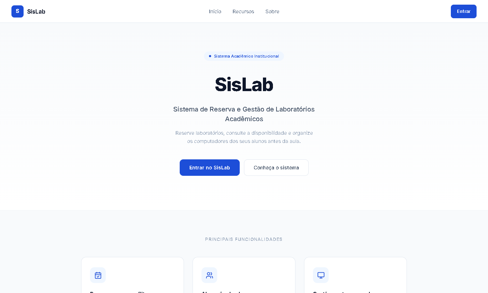 | 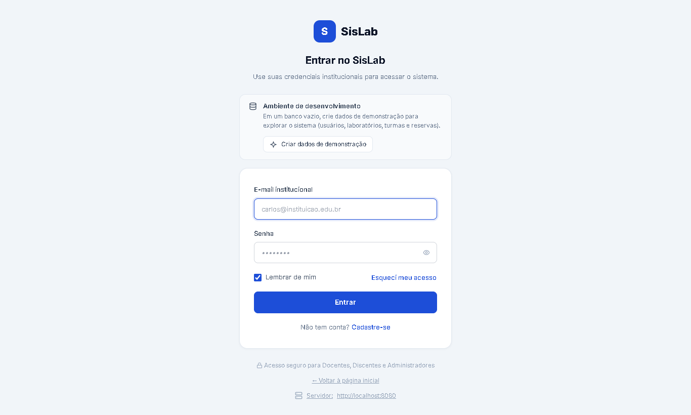 |

### Administrador

| Painel administrativo | Laboratório e mapa de computadores |
|---|---|
| 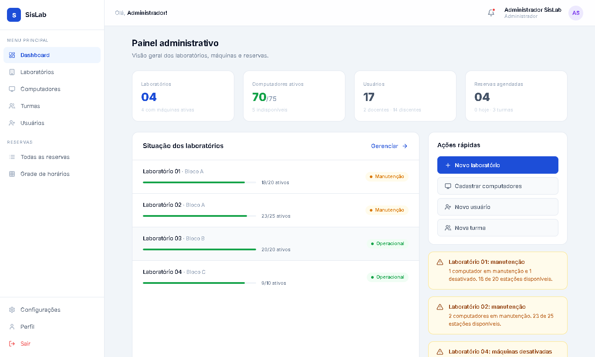 | 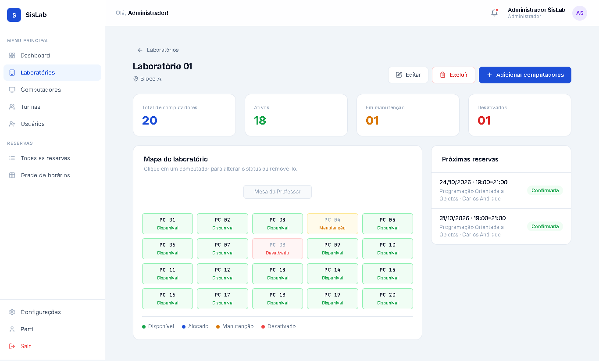 |

| Computadores | Usuários |
|---|---|
| 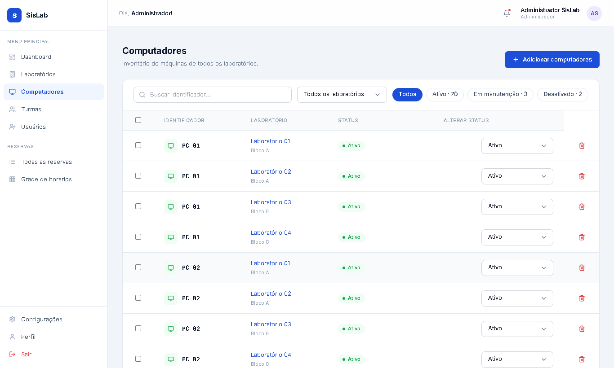 | 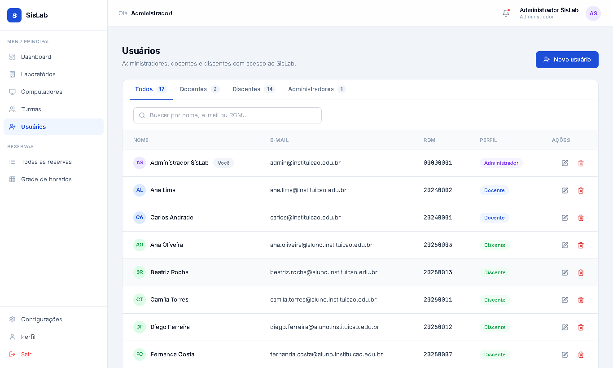 |

| Turmas | Grade de horários |
|---|---|
| 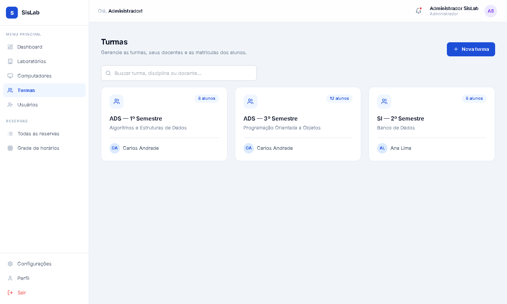 | 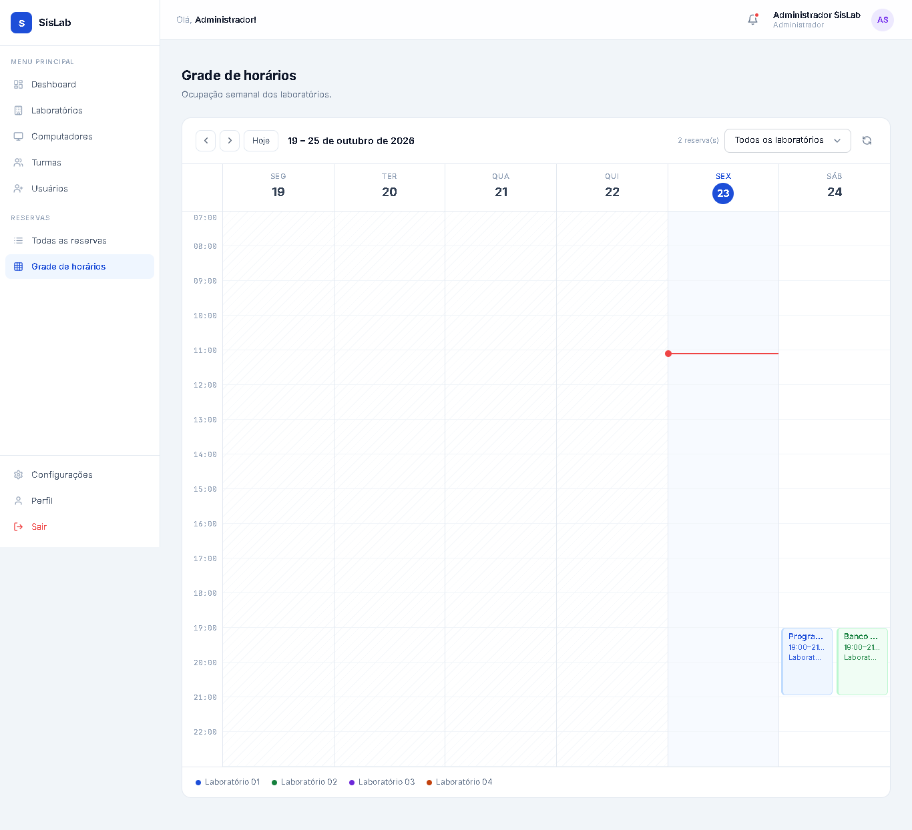 |

### Docente

| Painel do docente | Reservar laboratório (etapa 1 de 3) |
|---|---|
| 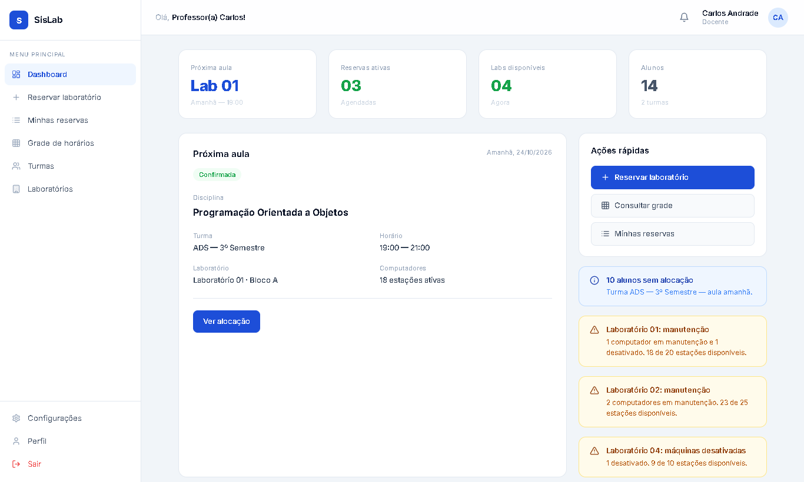 | 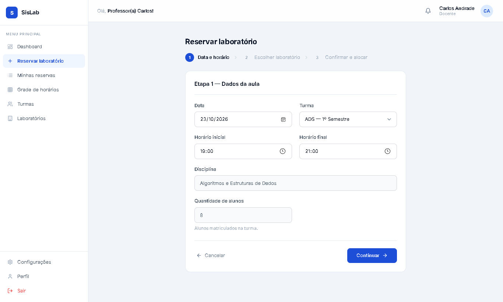 |

**Alocação de alunos nas máquinas de uma reserva**

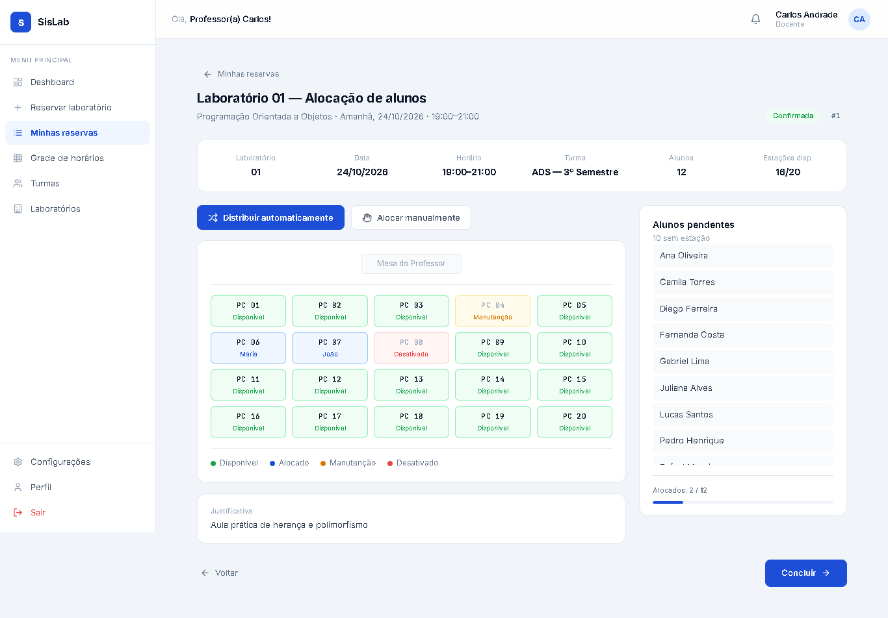

### Discente

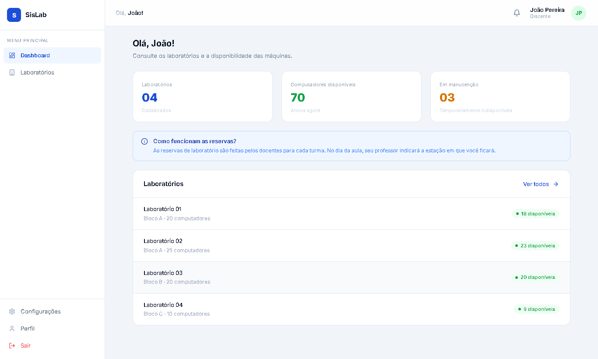

## Regras de negócio

- **RN01 — Sem conflito de horário:** não é possível criar uma reserva que se sobreponha a outra confirmada no mesmo laboratório e data. A sobreposição é detectada quando cada intervalo começa antes de o outro terminar, então reservas "encostadas" (10h–12h e 12h–14h) são permitidas. Retorna `409`.
- **RN02 — Capacidade:** o número de alunos alocados em uma reserva não pode exceder o número de máquinas ativas do laboratório.
- **RN03 — Máquina ativa:** só é possível alocar máquinas com status `ATIVO`.
- Apenas docentes criam reservas, e somente para turmas das quais são responsáveis.
- A reserva não pode ter data passada, e o horário de fim deve ser posterior ao de início.
- Na alocação, o aluno precisa pertencer à turma da reserva, a máquina precisa pertencer ao laboratório da reserva, e nem o aluno nem a máquina podem ser alocados duas vezes na mesma reserva.
- Somente o docente dono da reserva aloca alunos (o administrador apenas consulta).

## Tecnologias

| Camada | Tecnologia |
|---|---|
| Linguagem | Java 17 (compilado e testado com JDK 21) |
| Framework | Spring Boot 4.1.1 (Web MVC, Data JPA, Validation, Actuator) |
| Segurança | Spring Security, OAuth2 Resource Server (JWT HS256 via Nimbus), BCrypt |
| Banco de dados | MySQL 8.x (produção/desenvolvimento) e H2 em memória (testes) |
| Documentação da API | springdoc-openapi (Swagger UI) |
| Testes | JUnit 5, Mockito, Spring Boot Test |
| Utilitários | Lombok, Maven Wrapper |
| Frontend | HTML5, CSS3 e JavaScript (ES Modules), sem dependências |

## Como executar

### Pré-requisitos

- JDK 17 ou superior
- MySQL em `localhost:3306` **ou** Docker (para subir o MySQL com um comando)

### 1. Banco de dados

Com Docker:

```bash
docker compose up -d
```

Sem Docker, use o seu MySQL e ajuste usuário e senha em `src/main/resources/application.properties` (padrão: `root` / `root`). O banco `sislab` é criado automaticamente.

### 2. Aplicação

Na **raiz do projeto** (o backend precisa encontrar a pasta `frontend/`):

```bash
./mvnw spring-boot:run
```

No Windows (PowerShell): `.\mvnw.cmd spring-boot:run`

Um único comando sobe as duas partes:

| Parte | Endereço |
|---|---|
| API (backend) | http://localhost:8080 |
| Interface (frontend) | http://localhost:5500 |

Acesse **http://localhost:5500**. Abrir o `index.html` direto pelo explorador de arquivos não funciona, porque o navegador bloqueia ES Modules em `file://`.

### 3. Dados de demonstração

Com o banco vazio, na tela de login clique em **"Criar dados de demonstração"**. O front cadastra docentes, discentes, laboratórios, computadores, turmas, matrículas e reservas de exemplo. O botão só aparece quando a API está em `localhost`.

### Configurações principais (`application.properties`)

| Propriedade | Função |
|---|---|
| `server.port` | Porta da API (8080) |
| `sislab.frontend.porta` | Porta onde a pasta `frontend/` é servida (5500) |
| `spring.datasource.*` | Conexão com o MySQL |
| `sislab.jwt.secret` | Segredo de assinatura do JWT (mínimo de 32 caracteres) |
| `sislab.jwt.expiracao-minutos` | Validade do token (60) |
| `sislab.admin-inicial.*` | Administrador criado na primeira execução |
| `sislab.cors.allowed-origins` | Origens permitidas (acompanha a porta do front) |

## Usuários de demonstração

Todos com a senha `sislab123`.

| Perfil | E-mail | Observação |
|---|---|---|
| Administrador | `admin@instituicao.edu.br` | Criado pelo backend na primeira execução |
| Docente | `carlos@instituicao.edu.br` | Criado pelo botão de demonstração |
| Discente | `joao@aluno.instituicao.edu.br` | Criado pelo botão de demonstração |

> Estas credenciais e o segredo do JWT são **apenas para uso acadêmico/local**. Troque-os antes de qualquer uso real (veja [Segurança](#segurança)).

## Testes

```bash
./mvnw test
```

Usa H2 em memória (perfil `test`), portanto **não precisa do MySQL**. A suíte tem **57 testes** e cobre:

- Regras de reserva: permissão, dono da turma, horários inválidos, data passada e conflito de horário (`ReservaServiceTest`)
- Regras de alocação: dono da reserva, aluno na turma, máquina do laboratório, máquina ativa, duplicidades e capacidade (`AlocacaoServiceTest`)
- Turmas, matrículas e permissões por perfil (`TurmaServiceTest`)
- Laboratórios — CRUD restrito ao administrador (`LaboratorioTest`)
- Autenticação — credenciais válidas, senha errada, e-mail inexistente e usuário sem senha (`AuthServiceTest`)
- Geração de JWT e rejeição de token assinado com outra chave (`TokenServiceTest`)
- Servidor do frontend (`FrontendServerTest`) e carregamento do contexto Spring (`SislabApplicationTests`)

## Documentação da API

Com a aplicação rodando, a documentação interativa (Swagger UI) fica em **http://localhost:8080/swagger-ui.html**.

Exceto onde indicado, todas as rotas exigem o header `Authorization: Bearer <token>`.

| Recurso | Rotas |
|---|---|
| Autenticação | `POST /auth/login` (público), `POST /auth/logout` (público) |
| Usuários | `POST /usuario/cadastrar` (público para discente/docente), `GET /usuario/listaDiscente`, `GET /usuario/listaDocente`, `GET /usuario/listaAdm`, `PUT /usuario/{id}`, `DELETE /usuario/{id}` |
| Laboratórios | `POST /laboratorio`, `GET /laboratorio`, `GET /laboratorio/{id}`, `PUT /laboratorio/{id}`, `DELETE /laboratorio/{id}` |
| Computadores | `POST /computador`, `GET /computador`, `GET /computador/{id}`, `PUT /computador/{id}` (status), `DELETE /computador/{id}`, `GET /computador/{idLaboratorio}/mapa` |
| Turmas | `POST /turma`, `GET /turma`, `GET /turma/{id}`, `POST /turma/{id}/alunos` |
| Reservas | `POST /reserva`, `GET /reserva/{id}` |
| Alocações | `POST /reserva/{reservaId}/alocacoes`, `GET /reserva/{reservaId}/alocacoes` |

Exemplo de login:

```bash
curl -X POST http://localhost:8080/auth/login \
  -H "Content-Type: application/json" \
  -d '{"email":"admin@instituicao.edu.br","senha":"sislab123"}'
```

Resposta: `{ "token": "...", "id": 1, "nome": "...", "email": "...", "rgm": "...", "perfil": "ADMINISTRADOR" }`

Códigos de erro usados: `400` (validação), `401` (credenciais/token inválidos), `403` (sem permissão), `404` (não encontrado) e `409` (conflito de horário, duplicidade ou violação de regra).

## Estrutura do projeto

```
SisLab/
├── pom.xml
├── docker-compose.yml            # MySQL opcional
├── src/
│   ├── main/
│   │   ├── java/br/com/cs/sislab/
│   │   │   ├── config/           # CORS e servidor do frontend
│   │   │   ├── controller/       # endpoints REST
│   │   │   ├── dto/              # objetos de entrada/saída
│   │   │   ├── exception/        # tratamento global de erros
│   │   │   ├── model/            # entidades JPA
│   │   │   ├── repository/       # Spring Data JPA
│   │   │   ├── security/         # SecurityConfig, JWT, admin inicial
│   │   │   └── service/          # regras de negócio
│   │   └── resources/application.properties
│   └── test/                     # testes unitários e de contexto
└── frontend/
    ├── index.html                # shell da SPA
    ├── css/                      # tokens, base, componentes, layout, páginas
    └── js/
        ├── core/                 # router, cliente HTTP, sessão, templates com escape
        ├── services/             # um módulo por recurso da API
        ├── components/           # shell (sidebar/topbar), notificações
        └── views/                # uma tela por arquivo
```

O backend segue a arquitetura em camadas **Controller → Service → Repository**, com as regras de negócio concentradas nos *services*. Os controllers identificam o usuário logado pelo token (subject = id), nunca por um parâmetro enviado pelo cliente.

## Segurança

- Autenticação stateless com **JWT (HS256)**; o token carrega o `id` (subject) e o `perfil`.
- Senhas armazenadas com **BCrypt** (8 a 72 caracteres) e nunca serializadas na API (`@JsonIgnore` no hash).
- A mensagem de erro de login é a mesma para e-mail inexistente e senha errada, para não revelar quais e-mails existem.
- O cadastro público cria apenas discentes e docentes; criar administrador exige um administrador autenticado (verificado no banco).
- Autorização em duas camadas: rotas no `SecurityConfig` e regras por perfil/dono nos *services*.
- Frontend com templates que **escapam HTML automaticamente**, reduzindo o risco de XSS.
- O segredo do JWT, a senha do banco e a senha do administrador inicial em `application.properties` são valores de **desenvolvimento**. Em um ambiente real, mova-os para variáveis de ambiente.

## Limitações conhecidas

Pontos assumidos como fora do escopo desta entrega acadêmica:

- Não há `GET /reserva` (listagem) nem cancelamento de reserva na API. O enum `StatusReserva` já prevê `CANCELADA`, mas nenhum endpoint o utiliza. O frontend contorna a falta da listagem consultando `GET /reserva/{id}` em sequência.
- A alocação automática de alunos é feita no frontend; a API oferece somente a alocação individual.
- A verificação de conflito de horário (RN01) é feita por consulta antes de salvar, sem trava ou restrição no banco; duas requisições simultâneas podem, em teoria, passar pela verificação ao mesmo tempo.
- O token JWT fica no `localStorage`/`sessionStorage` do navegador e não é revogado no logout (vale até expirar, 60 min por padrão).
- O schema é gerenciado por `spring.jpa.hibernate.ddl-auto=update`, sem migrations (Flyway/Liquibase).
- Os testes são unitários (com Mockito) e de contexto; não há testes de integração dos endpoints nem testes automatizados do frontend.
- O Swagger UI e a documentação OpenAPI estão habilitados por padrão.

## Equipe

Projeto desenvolvido em grupo no GitHub: [GiovaniRamires/SisLab](https://github.com/GiovaniRamires/SisLab).

| Integrante | Papel |
|---|---|
| Giovani Ramires Cardoso dos Santos | Scrum Master |
| Jéssica Cristina da Silva Matos | Product Owner |
| Nicolas Henrique | Analista |
| Arthur Ramires Quirino | Arquiteto |
| Gabriel da Silva Messias | DevOps |
| Cauan da Paz Justino | Segurança |
| Arthur Oliveira Souza | Qualidade |

Papéis conforme a documentação inicial do projeto (*Documentação do Sistema SisLab*, disciplina de Engenharia de Software).

- **Instituição:** Universidade Cruzeiro do Sul
- **Professora:** Erika Estevam Freire Miranda
